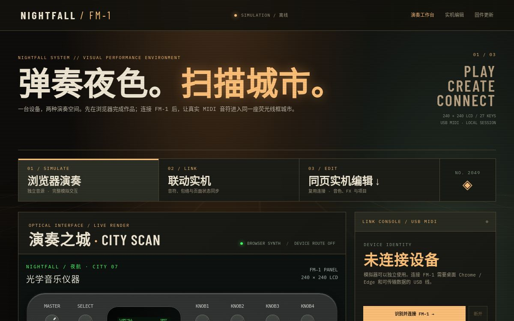
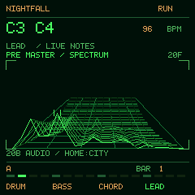

# NIGHTFALL FM-1

NIGHTFALL is an independent, cyberpunk-inspired performance firmware and browser studio for the M-VAVE FM-1. This repository contains the synthesizer, sequencer, FX, display renderer, USB-MIDI control protocol, web simulator, device editor, and browser updater source.



*Desktop browser preview. Open the public simulator below to play the full panel.*



*240 × 240 firmware renderer preview. For the full interactive panel, open the online simulator below; this is not a photograph of the hardware.*

**Experimental firmware — flash at your own risk.** The [`FM-1_999 GREEN2` package](web/firmware/NIGHTFALL-FM1-999-GREEN2.fwsc) has booted on one FM-1 and passed USB identity, parameter round-trip, MIDI note, and spectral-terrain protocol tests. Full panel/audio regression, long-run stability, official-firmware rollback, and recovery without external hardware are **not proven**. A failed update may leave the device unable to boot and require an external recovery tool. The USB VID/PID and product identity remain test-only. Do not flash the linker image in `firmware/build/`.

Download the [experimental pre-release](https://github.com/SylarPu-X/nightfall-fm1/releases/tag/v0.1.0-green2-experimental) with its matching source archive.

Online preview: [GitHub Pages](https://sylarpu-x.github.io/nightfall-fm1/). The simulator needs no hardware. The [browser updater](https://sylarpu-x.github.io/nightfall-fm1/update.html) requires desktop Chrome or Edge, Web MIDI with SysEx permission, device identification, package SHA-256 verification, and explicit risk confirmation. The built-in package has SHA-256 `8e72edc5d894b99efc556d20e64dfe4ea2bb59877920c5314d9befbf3f612be8`. The [corresponding source archive](web/source/NIGHTFALL-firmware-source-green2.tar.gz) contains the matching NIGHTFALL application source, Felucca GPL board/update code and loader source, JieLi SDK SPL/config assets, and licenses. This is **not** an M-VAVE official update.

## Layout

- `firmware/` — original NIGHTFALL application code, target adapter, tests, build and experimental packaging tools.
- `web/` — static performance simulator, device editor, USB-MIDI bridge, browser updater, and one explicitly experimental firmware package.

## Try the source locally

```sh
cd firmware
make test
make audio-test
make preview
```

To preview the browser studio, serve `web/` as the document root (for example, `python3 -m http.server 8000 --directory web`) and open `http://127.0.0.1:8000/`. The simulator runs without a device. USB-MIDI access requires a compatible browser and a connected FM-1.

The native target build requires a JieLi toolchain, the Felucca board-support checkout, and the vendor SPL/config assets. `firmware/README.md` and `firmware/NOTICE.md` document the build, current limits, and licensing. The build was tested against Felucca commit `a53ecf428c29c780108fd70a31b71a32a6b5c313` and JieLi SDK commit `d179b4484759423312073f5fbb232501aa491047`. These are external dependencies, not vendored application code.

## License and attribution

NIGHTFALL source is released under **GPL-3.0-only**; see `LICENSE`. It uses Felucca's GPL-3.0-only FM-1 startup, HAL, USB-MIDI/update infrastructure and packaging tools as external dependencies. The web editor/update code also contains GPL-licensed Felucca Web App components. Fonts, the optional piano sample, and other third-party pieces retain their own notices; see `THIRD_PARTY.md`, `web/source/LICENSING.md`, and `web/editor/samples/PIANO_HD.txt`.

This is an independent community project, not an M-VAVE product or an official update. Film-inspired visual direction does not include copyrighted film footage, audio, or logos.
